![Cabecera][header]

# Hey! soy Angel ^_^
[![LinkedIn][linkedin]][linkedin_link] [![AUR][aur]][aur_link] [![Codeforces][cf]][cf_link]

![Presentación animada][typing]

Desarrollador de software con enfoque en compiladores a bajo nivel.
He participado en dos ediciones de ICPC representando a la Universidad de San Carlos de Guatemala.
Dispongo de buenas habilidades en solución de problemas algorítmicos.

# Mis herramientas

# Estadísticas

![Racha][streak]

![Serpiente comiéndose las contribuciones][snake]

![Visitas][visitas]

![Pie de página][footer]

<!-- Imágenes animadas -->
[header]: https://capsule-render.vercel.app/api?type=waving&color=0:1a0b2e,50:7c3aed,100:e879f9&height=160&section=header&animation=fadeIn
[footer]: https://capsule-render.vercel.app/api?type=waving&color=0:e879f9,50:7c3aed,100:1a0b2e&height=100&section=footer
[typing]: https://readme-typing-svg.demolab.com/?font=Fira+Code&weight=600&size=20&pause=1200&color=C084FC&vCenter=true&width=560&lines=Compiladores+a+bajo+nivel+;Dos+ediciones+de+ICPC+con+la+USAC;C%2B%2B+%C2%B7+Rust+%C2%B7+algoritmos
[streak]: https://streak-stats.demolab.com/?user=Angelius6573&locale=es&background=1A0B2E&border=A855F7&stroke=7C3AED&ring=A855F7&fire=E879F9&currStreakNum=FFFFFF&sideNums=FFFFFF&currStreakLabel=E879F9&sideLabels=D8B4FE&dates=A78BFA
[snake]: https://raw.githubusercontent.com/Angelius6573/Angelius6573/output/snake-morado.svg
[visitas]: https://komarev.com/ghpvc/?username=Angelius6573&style=plastic&color=7c3aed&label=Visitas

<!-- Shields -->
[linkedin]: https://img.shields.io/badge/LinkedIn-0A66C2?style=plastic&logo=data:image/svg%2bxml;base64,PHN2ZyB4bWxucz0iaHR0cDovL3d3dy53My5vcmcvMjAwMC9zdmciIHZpZXdCb3g9IjAgMCAyNTYgMjU2Ij48cGF0aCBmaWxsPSIjZmZmIiBkPSJNMjE4IDIxOGgtMzh2LTU5YzAtMTQgMC0zMy0yMC0zM3MtMjMgMTYtMjMgMzJ2NjBIOTlWOTZoMzZ2MTdoMWE0MCA0MCAwIDAgMSAzNi0yMGMzOCAwIDQ2IDI1IDQ2IDU4ek01NyA3OWEyMiAyMiAwIDEgMSAwLTQ0IDIyIDIyIDAgMCAxIDAgNDRtMTkgMTM5SDM4Vjk2aDM4ek0yMzcgMEgxOUM5IDAgMCA4IDAgMTh2MjIwYzAgMTAgOSAxOCAxOSAxOGgyMThjMTAgMCAxOS04IDE5LTE4VjE4YzAtMTAtOS0xOC0xOS0xOCIvPjwvc3ZnPgo=
[linkedin_link]: https://www.linkedin.com/in/angel-ra%C3%BAl-herrera-chilel
[aur]: https://img.shields.io/badge/AUR-Angel%20Herrera-1793D1?style=plastic&logo=archlinux&logoColor=1793D1&labelColor=FFFFFF
[aur_link]: https://aur.archlinux.org/account/Angelius6573
[cf]: https://img.shields.io/badge/ICPC-FFFFFF?style=plastic&label=Codeforces&labelColor=B22C1B&logo=data:image/svg%2bxml;base64,PHN2ZyB4bWxucz0iaHR0cDovL3d3dy53My5vcmcvMjAwMC9zdmciIHZpZXdCb3g9Ii00MCAtODQgNDg0IDQ4NCI+PGRlZnM+PGxpbmVhckdyYWRpZW50IGlkPSJhIj48c3RvcCBzdG9wLWNvbG9yPSIjZjdjNTNmIi8+PHN0b3Agb2Zmc2V0PSIxIiBzdG9wLWNvbG9yPSIjZmNkOTczIi8+PC9saW5lYXJHcmFkaWVudD48bGluZWFyR3JhZGllbnQgaWQ9ImIiPjxzdG9wIHN0b3AtY29sb3I9IiMxNTgxYzUiLz48c3RvcCBvZmZzZXQ9IjEiIHN0b3AtY29sb3I9IiMxYzk4ZDQiLz48L2xpbmVhckdyYWRpZW50PjxsaW5lYXJHcmFkaWVudCBpZD0iYyI+PHN0b3Agc3RvcC1jb2xvcj0iI2IyMWUyNiIvPjxzdG9wIG9mZnNldD0iMSIgc3RvcC1jb2xvcj0iI2MyMWMyNCIvPjwvbGluZWFyR3JhZGllbnQ+PC9kZWZzPjxyZWN0IHg9Ii00MCIgeT0iLTg0IiB3aWR0aD0iNDg0IiBoZWlnaHQ9IjQ4NCIgcng9IjcwIiBmaWxsPSIjZmZmIi8+PHJlY3QgeT0iODkiIHdpZHRoPSIxMDgiIGhlaWdodD0iMjI3IiByeD0iMjIiIGZpbGw9InVybCgjYSkiLz48cmVjdCB4PSIxNDgiIHdpZHRoPSIxMDgiIGhlaWdodD0iMzE2IiByeD0iMjIiIGZpbGw9InVybCgjYikiLz48cmVjdCB4PSIyOTYiIHk9IjEyMyIgd2lkdGg9IjEwOCIgaGVpZ2h0PSIxOTMiIHJ4PSIyMiIgZmlsbD0idXJsKCNjKSIvPjwvc3ZnPgo=
[cf_link]: https://codeforces.com/profile/Angelius6573
